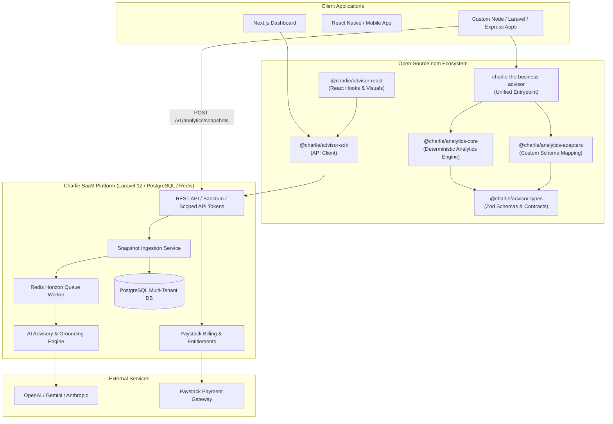

# Charlie the Business Advisor — Technical Architecture

## 1. System Vision

Charlie the Business Advisor is a dual-tier commercial analytics and AI advisory platform:
1. **Tier A (Open-Source Core):** An offline, deterministic TypeScript analytics library (`@charlie/analytics-core`, `@charlie/advisor-types`, `@charlie/analytics-adapters`, and `charlie-the-business-advisor`) that calculates sales volume, revenue recognition, Pareto distributions, customer cohorts, RFM segmentation, product profitability, and moving averages.
2. **Tier B (SaaS Advisory Cloud):** A multi-tenant Laravel 12 API with PostgreSQL, Redis, and an AI advisory orchestration layer that ingests deterministic snapshots, validates data completeness, discovers actionable growth opportunities, and grounds recommendations strictly against verified figures.

## 2. High-Level Component Topology

## 3. Data Integrity & Financial Accounting Rules

1. **Integer Minor Units:** All monetary values stored and processed use integer minor units (e.g. cents, kobo) alongside ISO-4217 currency codes. No JavaScript IEEE-754 floating point arithmetic is used for financial totals.
2. **Revenue Recognition:**
   - **Gross Merchandise Value (GMV):** All non-cancelled orders at list price.
   - **Net Sales Recognized:** Orders with status `completed` or `partially_refunded`: items total + tax + shipping - discounts - refund amounts.
   - **Excluded from recognized revenue:** `pending`, `failed`, and `cancelled` orders.
3. **Data Completeness & Zero-Hallucination Policy:**
   - When product cost information is missing, Charlie does not guess COGS or margin; it reports gross profit as `null` with a clear `DATA_INCOMPLETE: MISSING_COGS` signal.
   - When customer identifiers are absent, repeat purchase rates and RFM segments are reported as `insufficient_data` rather than generating artificial numbers.
4. **Evidence Grounding in AI Advisory:**
   - Every numerical metric cited by the AI advisor must match an analytical observation in the stored snapshot.
   - Recommendations that contain ungrounded numbers or impossible percentage gains are rejected by the validation pipeline before being persisted or delivered to users.
